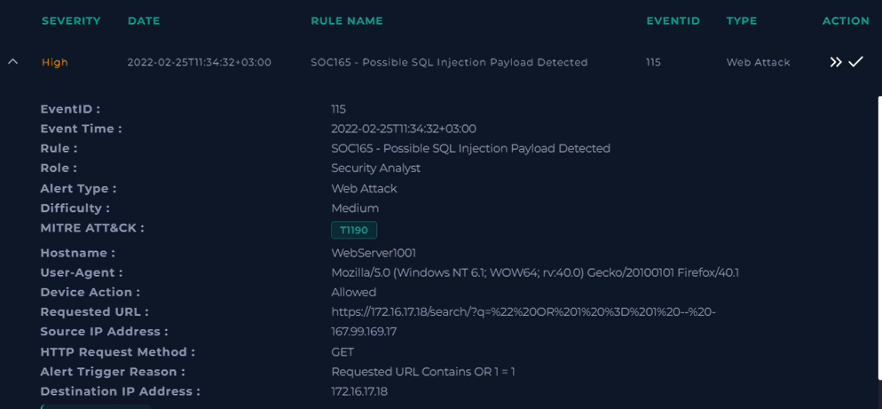
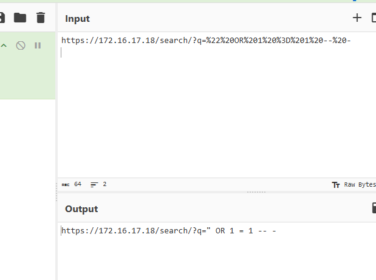
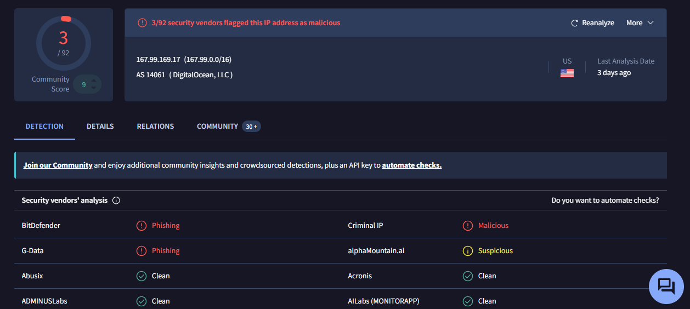

# SOC165 – Possible SQL Injection Payload Detected

## Overview

This investigation was performed as part of a hands-on SOC analyst training exercise using LetsDefend.

The activity involved a suspicious HTTP GET request targeting a web application's search functionality. The requested URL contained a SQL injection-style payload using `OR 1 = 1`, which triggered a security alert.

The investigation focused on analyzing the alert, decoding the requested URL, reviewing firewall logs, and checking the source IP address using VirusTotal.

| Category | Details |
|---|---|
| Platform | LetsDefend |
| Alert ID | 115 |
| Alert Name | SOC165 – Possible SQL Injection Payload Detected |
| Alert Type | Web Attack |
| Difficulty | Medium |
| Role | Security Analyst |
| MITRE ATT&CK | T1190 – Exploit Public-Facing Application |
| Target Hostname | WebServer1001 |
| Investigation Result | SQL injection attempt detected; successful exploitation unconfirmed |

---

## 1. Initial Alert Analysis

The investigation started with an alert generated for a possible SQL injection attempt against a web application.

The alert contained the following information:

| Field | Value |
|---|---|
| Event Time | 2022-02-25 11:34:32 (+03:00) |
| Source IP | 167.99.169.17 |
| Destination IP | 172.16.17.18 |
| HTTP Method | GET |
| Destination Port | 443 |
| Requested Endpoint | `/search/` |
| Device Action | Allowed |
| Alert Trigger Reason | Requested URL contains `OR 1 = 1` |
| User-Agent | Firefox 40.1 on Windows 7 |

The requested URL contained a suspicious parameter that included a SQL injection-style expression.

### Alert Overview



*Figure 1: Initial security alert showing the suspicious HTTP request and associated network information.*

---

## 2. URL Decoding and Payload Analysis

I examined the requested URL to understand the payload that triggered the alert.

Since the URL contained encoded characters, I used **CyberChef** to decode the request and inspect its contents.

**Decoded payload:**

```sql
" OR 1 = 1 -- -
```

### Payload Analysis

- `"` – A double quotation mark that may be used to interact with the application's query syntax.
- `OR 1 = 1` – A Boolean condition that always evaluates to true.
- `-- -` – A comment sequence commonly used to ignore the remaining portion of an SQL query.

This payload is consistent with a SQL injection attempt. An attacker may use this technique to manipulate the logic of an application's SQL query.

### CyberChef Analysis



*Figure 2: URL decoding in CyberChef revealing the SQL injection-style payload.*

---

## 3. Source IP Investigation – VirusTotal

After identifying the suspicious request, I checked the source IP address using VirusTotal to gather additional threat intelligence.

**Source IP:** `167.99.169.17`

### VirusTotal Results

| Field | Result |
|---|---|
| IP Address | 167.99.169.17 |
| Detection Ratio | 3/92 |
| Network | 167.99.0.0/16 |
| ASN | AS14061 |
| Organization | DigitalOcean, LLC |
| Country | United States |

Three out of 92 security vendors flagged the IP address.

The results provided an additional reputation indicator. However, a low detection ratio alone is not sufficient to confirm that an IP address is malicious.

The IP reputation was therefore considered supporting evidence rather than definitive proof of malicious activity.

### VirusTotal Analysis



*Figure 3: VirusTotal IP address analysis showing 3 out of 92 security vendor detections.*

---

## 4. Firewall and Log Analysis

I reviewed the corresponding firewall event in the log management section to understand how the request was handled.

### Firewall Log Details

| Field | Value |
|---|---|
| Log Type | Firewall |
| Source Address | 167.99.169.17 |
| Source Port | 48575 |
| Destination Address | 172.16.17.18 |
| Destination Port | 443 |
| Device Action | Permitted |
| HTTP Response Status | 500 |

### Observations

**1. Firewall Action – Permitted**

The firewall permitted the request, meaning the traffic was allowed through that security control to reach the destination.

**2. HTTP Response – 500 Internal Server Error**

The web server returned an HTTP 500 response, indicating that an internal server-side error occurred while processing the request.

This does not confirm whether the SQL injection was successful or whether the database was affected.


---

## 5. MITRE ATT&CK Mapping

| Technique ID | Technique Name | Relevance |
|---|---|---|
| T1190 | Exploit Public-Facing Application | The suspicious request attempted to exploit a web application's search functionality through a crafted SQL injection payload. |

The observed activity is consistent with an attempted exploitation of a web-facing application.

---

## 6. Investigation Findings

Based on the available alert information, firewall logs, URL analysis, and threat intelligence results, the following findings were identified:

1. A suspicious HTTP GET request targeted the web application's search endpoint.
2. The requested URL contained a SQL injection-style payload using `OR 1 = 1`.
3. CyberChef was used to decode the URL and examine the submitted payload.
4. The firewall permitted the request to reach the destination web server.
5. The web server returned an HTTP 500 Internal Server Error.
6. VirusTotal reported that 3 out of 92 security vendors flagged the source IP address.
7. The available evidence did not establish successful SQL injection, unauthorized database access, or data exfiltration.

---

## 7. Recommended Actions

If this activity were observed in a production environment, I would recommend the following actions:

- **Review Web Server Logs:** Examine access and error logs for additional suspicious requests and application errors.
- **Investigate Database Activity:** Review database logs to determine whether the crafted request resulted in unexpected SQL execution.
- **Check Related Traffic:** Search for other suspicious requests originating from the same source IP address.
- **Review WAF Rules:** Verify whether the Web Application Firewall has appropriate SQL injection detection and prevention rules.
- **Validate Application Security:** Ensure that user input is properly validated and parameterized SQL queries are used.
- **Escalate if Necessary:** Escalate the investigation if evidence of successful exploitation or unauthorized database access is identified.

---

## 8. Final Assessment

The investigation identified a suspected SQL injection attempt targeting the search functionality of a web application.

The request contained a Boolean-based SQL injection-style payload and was permitted by the firewall. The destination web server subsequently returned an HTTP 500 Internal Server Error.

VirusTotal also showed 3 out of 92 security vendor detections for the source IP address.

Based on the available evidence, the activity is classified as a **suspected SQL injection attempt with successful exploitation unconfirmed**.

Further investigation of web application and database logs would be necessary to determine whether the request resulted in any successful exploitation.

---

